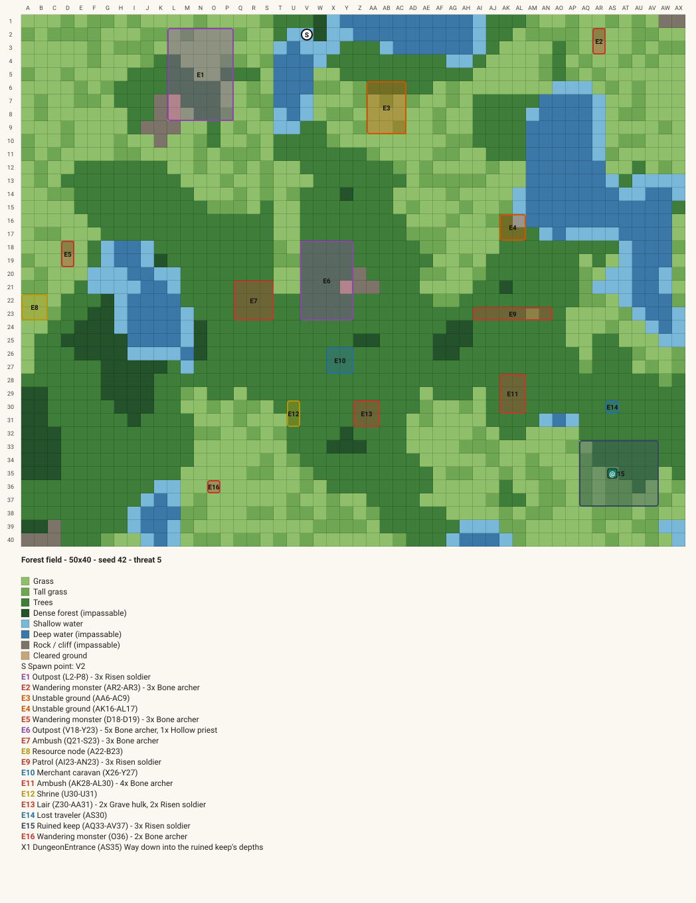
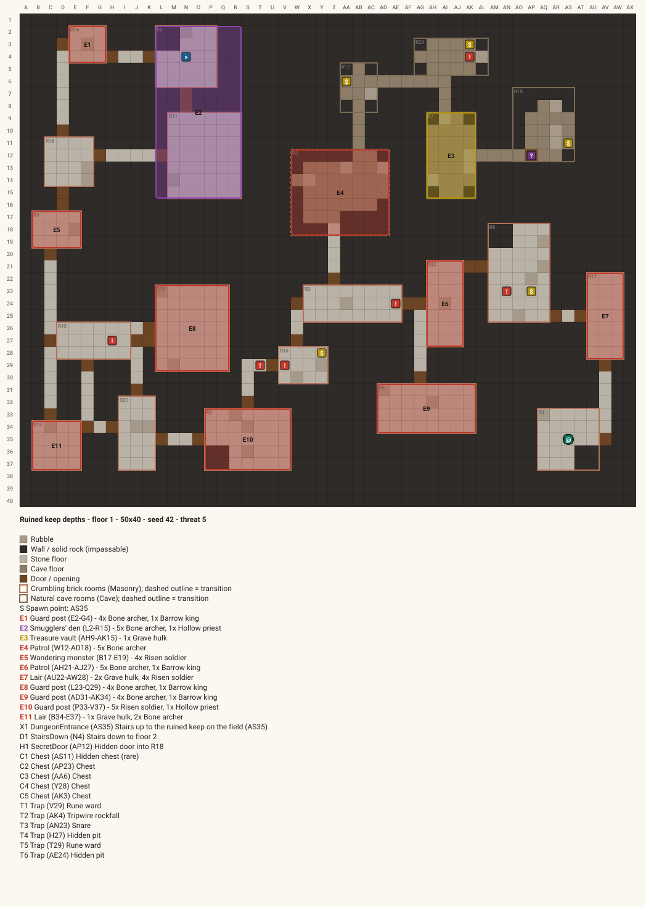

# Realm Weaver

[](https://github.com/Dsmith515/realm-weaver/actions/workflows/ci.yml)

A procedural map generator for grid-based tactics and TTRPG play, inspired by the "keyword" portals of .Hack.

You combine **ritual components** to open a portal to a realm:

| Component | Role | Consumed? |
|---|---|---|
| **Needle** | Difficulty, and the compass inside the realm | No |
| **Thread** | Biome and element | Yes |
| **Coating** | Mob types, and whether the realm is a field, a dungeon, or a field with a dungeon | Yes |
| **Map** | A record of a realm you've already visited, which acts as its seed | No |

The generator builds a seeded field or a dungeon of up to 3 floors. It places encounters, events, traps, chests and secret rooms, labels everything with alphanumeric grid coordinates, and exports the result as an **SVG** or as an **image-generation prompt**.

The project is also a learning portfolio. It starts as a **modular monolith with ACID transactions**, then splits into **microservices with a saga and a transactional outbox**, with CI/CD and testing at every layer. See the [roadmap](docs/roadmap.md) and the [architecture decision records](docs/adr).

## Stack

- **Backend:** C# / ASP.NET Core (.NET 10) minimal APIs, EF Core and PostgreSQL
- **Frontend:** React, TypeScript and Vite, with React Router and TanStack Query
- **Tests:** xUnit (with Testcontainers), Vitest with React Testing Library, and Playwright
- **Infrastructure:** Docker Compose, plus GitHub Actions for CI that pushes images to GHCR

## Getting started

Prerequisites: .NET 10 SDK, Node 24+ and Docker Desktop.

```bash
# 1. Database
docker compose up -d

# 2. API  ->  http://localhost:5080  (OpenAPI document at /openapi/v1.json)
#    Applies migrations and seeds the starter catalog and a demo player ("Wanderer") on startup.
dotnet run --project src/backend/RealmWeaver.Api

# 3. Web  ->  http://localhost:5173  (proxies /api to the API)
cd src/frontend && npm install && npm run dev
```

### Tests

```bash
dotnet test RealmWeaver.slnx      # API tests start their own Postgres container, so Docker must be running
cd src/frontend && npm run lint && npm test
```

### API

| Endpoint | What it does |
|---|---|
| `GET/POST /api/components`, `GET/PUT/DELETE /api/components/{id}` | Component catalog. Filter with `type`, `rarity`, `biome`, `search`, `assignable`, `includeArchived`, `page`, `pageSize`. Delete archives. |
| `POST /api/components/{id}/assign` | Admin: give a component to a player |
| `GET/PUT /api/settings` | The global `playersCanSelfAssign` toggle |
| `GET/POST /api/players`, `GET /api/players/{id}` | Players. A new player gets the starter kit. |
| `GET/POST /api/players/{id}/inventory` | A player's inventory, and adding to it yourself (when allowed) |
| `POST /api/rituals/preview` | Resolve the four slots: map auto-fill, `randomize`, mismatch and danger, and what's missing |
| `POST /api/rituals` (header `Idempotency-Key`), `GET /api/rituals/{id}` | Perform a ritual in one transaction. Retrying with the same key replays the result. |
| `GET /api/realms?playerId=&mapId=`, `GET /api/realms/{id}` | Realm summaries, and a full realm with its generated document |
| `GET /api/realms/{id}/export?format=svg\|prompt\|json\|md&area=` | Exports. `svg` and `prompt` are per area (field or `floor-N`). |

Errors are ProblemDetails: `400` with field errors, `403`, `404`, `409` for a concurrency conflict or missing components, and `422` for a reused idempotency key. See [ADR 0005](docs/adr/0005-ritual-transaction.md) for the ritual rules.

### Database migrations

Each module has its own DbContext and Postgres schema (see [ADR 0004](docs/adr/0004-module-owned-persistence.md)).

```bash
dotnet tool restore
dotnet ef migrations add <Name> --context CatalogDbContext   --project src/backend/RealmWeaver.Modules.Catalog --startup-project src/backend/RealmWeaver.Api -o Persistence/Migrations
```

### Generate a realm from the command line

```bash
dotnet run --project tools/RealmWeaver.Cli -- --seed 42 --biome forest --size 40x30 --events 12 --mobs beast
# writes samples/forest-42.svg, .prompt.txt (image-generation prompt), .md (placement sheet) and .json
```

Biomes: `plains`, `forest`, `desert`, `tundra`, `swamp`, `volcanic`, `mountains`, `coast`. Add `--kind fieldwithdungeon --floors 3` (or `--kind dungeon`) for dungeons. Run with `--help` for every option.

| Field with a ruined keep (seed 42) | Floor 1 beneath the keep: brick core branching into cave |
|---|---|
|  |  |

## Repository layout

```
src/backend/
  RealmWeaver.Api                ASP.NET Core host: endpoints, OpenAPI, composition root
  RealmWeaver.Generation         pure, deterministic map generation (no EF or ASP.NET)
  RealmWeaver.Infrastructure     shared persistence and HTTP plumbing (no module references)
  RealmWeaver.Modules.*          Catalog, Inventory, Rituals and Realms: endpoints, DbContext, migrations
src/frontend/                    React + TypeScript + Vite app
tools/RealmWeaver.Cli           command-line generator for samples
tests/                           xUnit test projects
docs/                            roadmap, ADRs and images
```

## Status

- [x] Milestone 1: scaffold, CI, docs
- [x] Milestone 2: generation library (fields, events, labels, exports)
- [x] Milestone 3: dungeons (floors, material themes, dungeon events)
- [x] Milestone 4: persistence and APIs (catalog, players, inventory)
- [x] Milestone 5: ritual transaction (preview, idempotent perform, realms and exports)
- [ ] Milestone 6: frontend pages
- [ ] Milestone 7: E2E tests and release images
- [ ] Milestone 8: microservices (saga and outbox)
- [ ] Milestone 9: content tables (mobs, events, difficulty templates)
