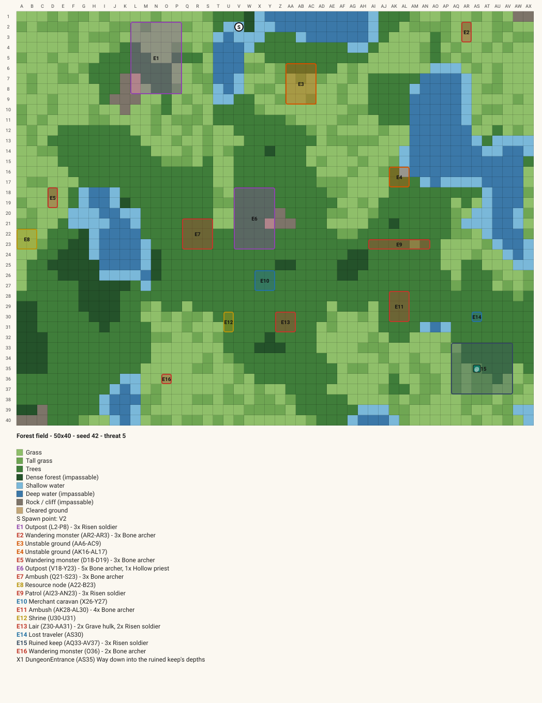
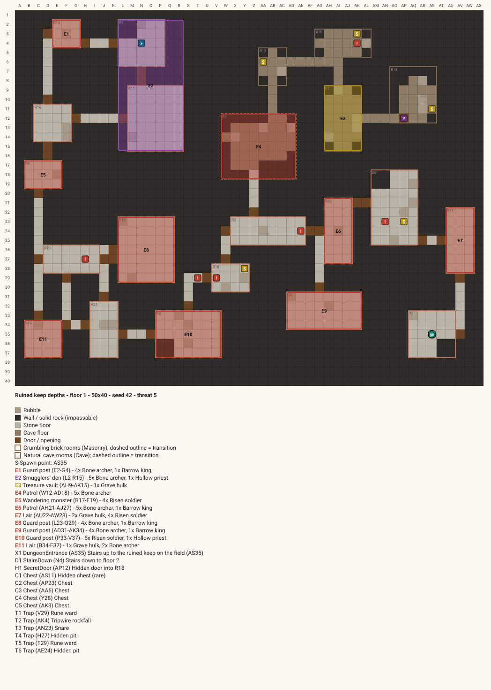

# Realm Weaver

[](https://github.com/Dsmith515/realm-weaver/actions/workflows/ci.yml)
[](https://github.com/Dsmith515/realm-weaver/actions/workflows/e2e.yml)
[](https://github.com/Dsmith515/realm-weaver/actions/workflows/release.yml)

A procedural map generator for grid-based tactics and TTRPG play, inspired by the "keyword" portals of .Hack.

You combine **ritual components** to open a portal to a realm:

| Component | Role | Consumed? |
|---|---|---|
| **Needle** | Difficulty, and the compass inside the realm | No |
| **Thread** | Biome and element | Yes |
| **Coating** | Mob types, and whether the realm is a field, a dungeon, or a field with a dungeon | Yes |
| **Map** | A record of a realm you've already visited, which acts as its seed | No |

The generator builds a seeded field or a dungeon of up to 3 floors. It places encounters, events, traps, chests and secret rooms, labels everything with alphanumeric grid coordinates, and exports the result as an **SVG** or as an **image-generation prompt**.

The project is also a learning portfolio. It starts as a **modular monolith with ACID transactions**, then splits into **microservices with a saga and a transactional outbox**, with CI/CD and testing at every layer. See the [roadmap](docs/roadmap.md) and the [architecture decision records](docs/adr).

## Stack

- **Backend:** C# / ASP.NET Core (.NET 10) minimal APIs, EF Core and PostgreSQL
- **Frontend:** React, TypeScript and Vite, with React Router and TanStack Query
- **Tests:** xUnit (with Testcontainers), Vitest with React Testing Library, and Playwright
- **Infrastructure:** Docker Compose, plus GitHub Actions for CI that pushes images to GHCR

## Getting started

Prerequisites: .NET 10 SDK, Node 24+ and Docker Desktop.

```bash
# 1. Database
docker compose up -d

# 2. API  ->  http://localhost:5080  (OpenAPI document at /openapi/v1.json, interactive reference at /scalar)
#    Applies migrations and seeds the starter catalog and a demo player ("Wanderer") on startup.
dotnet run --project src/backend/RealmWeaver.Api

# 3. Web  ->  http://localhost:5173  (proxies /api to the API)
cd src/frontend && npm install && npm run dev
```

**Everything in containers.** To try the app without the .NET SDK or Node, run the whole stack in Docker. Then open http://localhost:8080:

```bash
docker compose --profile full up -d --build   # Postgres, API and web (nginx serves the app and proxies /api)
docker compose --profile full down            # stop it; add -v to also drop the database
```

The containers run the API in Production, so `/scalar` and `/openapi/v1.json` are only available from `dotnet run`.

**Published images.** Every push to `main` publishes `ghcr.io/dsmith515/realm-weaver-api` and `ghcr.io/dsmith515/realm-weaver-web` to GitHub Container Registry, tagged `edge` and `sha-<commit>`. A `v1.2.3` tag adds `1.2.3`, `1.2` and `latest`. To run them instead of building locally:

```bash
export REALMWEAVER_API_IMAGE=ghcr.io/dsmith515/realm-weaver-api:edge
export REALMWEAVER_WEB_IMAGE=ghcr.io/dsmith515/realm-weaver-web:edge
docker compose --profile full up -d --no-build
```

### Tests

```bash
dotnet test RealmWeaver.slnx      # API tests start their own Postgres container, so Docker must be running
cd src/frontend && npm run lint && npm test
```

End-to-end tests (Playwright) run against the containerized stack. They cover a new player's random ritual, the realm page and its exports, the GM completing an objective and handing out the map, and a GM Quick Weave. Each test creates its own player, so they run against any database.

```bash
docker compose --profile full up -d --build --wait   # from the repo root
cd src/frontend && npx playwright install chromium   # once
npm run e2e                                          # E2E_BASE_URL=... to test another deployment
```

### API

**Reference.** With the API running in Development, open http://localhost:5080/scalar for an interactive reference where you can try requests. The raw OpenAPI document is at `/openapi/v1.json`. Without a running API, the committed copy at [`src/frontend/openapi/realm-weaver.json`](src/frontend/openapi/realm-weaver.json) is the same document, and CI keeps it in sync (see **API contract** below). Both the reference and the document are Development-only, since there's no authentication yet.

| Endpoint | What it does |
|---|---|
| `GET /api/info` | API name and version |
| `GET/POST /api/components`, `GET/PUT/DELETE /api/components/{id}` | Component catalog. Filter with `type`, `rarity`, `biome`, `search`, `assignable`, `includeArchived`, `page`, `pageSize`; order with `sort=name\|type\|rarity\|rank\|assignable\|created` and `desc`. Delete archives. |
| `GET /api/components/name-suffixes` | The words a Needle, Thread or Coating name may end with |
| `POST /api/components/{id}/assign` | Admin: give a component to a player |
| `GET/PUT /api/settings` | The global `playersCanSelfAssign` toggle |
| `GET/POST /api/players`, `GET /api/players/{id}` | Players, searchable by name (`search`, `limit`). A new player gets the starter kit and is attuned to the beginner needle. |
| `PUT` / `DELETE /api/players/{id}/attunement` | Attune one of the player's needles (body `{ needleId }`), or clear it. The attuned needle's abilities and boon go on the realm sheet. |
| `GET/POST /api/players/{id}/inventory` | A player's inventory, and adding to it yourself (when allowed) |
| `PUT /api/players/{id}/inventory/{componentId}/notes` | Replace a player's notes on an item they own |
| `GET /api/maps/{id}/details` | Map details: seed, kind, threat, mobs, potential loot and resource nodes |
| `POST /api/rituals/preview` | Resolve the four slots: map auto-fill, `randomize`, mismatch and danger, and what's missing |
| `POST /api/rituals` (header `Idempotency-Key`), `GET /api/rituals/{id}` | Perform a ritual in one transaction. Retrying with the same key replays the result. |
| `GET /api/realms?playerId=&mapId=&gm=&page=&pageSize=`, `GET /api/realms/{id}` | A page of realm summaries, and a full realm with its generated document |
| `GET /api/realms/{id}/completions` | The completion history of the realm's map (every run of it), and everyone who completed an objective there, with the first party marked |
| `GET /api/realms/{id}/export?format=svg\|prompt\|json\|md&area=` | Exports. `svg` and `prompt` are per area (field or `floor-N`). |
| `GET /api/realms/{id}/objectives/candidates` | Every objective a GM can pin: the rolled ones, then the other event hooks and realm-wide objectives |
| `PUT` / `DELETE /api/realms/{id}/pinned-objective` | Pin an objective (body `{ key }`) or clear the pin. Stored on the realm, never on the map. |
| `POST /api/realms/{id}/completion` | GM: record that a party completed an objective (body `{ objectiveKey, playerIds, mapRecipientIds? }`) and hand the map to those who don't hold it. Repeatable for any party (ADR 0011). Rituals never grant maps. |
| `POST /api/gm/weave/preview`, `POST /api/gm/weave` | GM Quick Weave: resolve a realm from the whole catalog (chosen slots as given, empty ones random within the limits) without saving, then weave it. Nothing is consumed. |

Errors are ProblemDetails: `400` with field errors, `403`, `404`, `409` for a concurrency conflict or missing components, and `422` for a reused idempotency key. See [ADR 0005](docs/adr/0005-ritual-transaction.md) for the ritual rules.

### Frontend

| Page | What it does |
|---|---|
| **Ritual** | Drag items from your inventory onto the four slots (or click them). The preview shows map auto-fill, the mismatch warning and anything missing. **Random** fills empty slots from your items; **Perform** opens the portal. Size and event count are under **Advanced**. Any needle you own can weave; a needle of the map's base type (any Beginner's Needle) still matches it. Ingredients woven before reopen the same realm, even without its map, unless the GM sealed it. |
| **Player** | Your attuned needle (its abilities and boon go on the realm sheet). Your inventory grouped by type, and adding assignable components yourself (when the admin allows it). Open an item to keep your own notes on it; a map also shows its details (seed, recipe, threat, mobs, potential loot and resource nodes). |
| **Realms** | Your realms. A realm shows the server-rendered SVG with zoom, pan and floor tabs; Its **Objectives** (1–3, complete any one) jump to their event on the map; a GM can pin any candidate objective. **Complete an objective (GM)** records it for the party you tick (search to find players) and hands the map to those who don't hold it; any party can complete it again later, and **Player completion** lists everyone who has, with the first party marked. **Map details** shows the GM's view of what the map holds. Structure ideas (when suggested) are listed under their settlement. Click a placement to highlight it. Exports download as SVG, Markdown or JSON; the image prompt opens in a window with Copy and Download. |
| **Components** | Admin catalog: filter, sort by any column header, create, edit (click a name; maps open on their **Map details** tab), clone (a clone must differ from its template), archive, assign to a player (with player search), and the self-assign switch. Needles have a base type and a boon; maps have rules (Map required seals a map to its holders; Components must match; Unique). |
| **Quick Weave** | GM tool for one-shots: a realm from the whole catalog, with no inventory checks and nothing consumed. Pick each slot or leave it random within the limits (rarity, tier range, biome, realm kind, each with Select all), set size and settlement options (structures are off by default; ask for placed structures or just structure ideas), **Roll** to preview, re-roll single slots, then **Weave** exactly what's shown. The new map belongs to no one until you assign it. |
| **About** | What Realm Weaver is for and how a ritual works. |

The navigation leads with the GM pages (Quick Weave, Realms, Components). Ritual and Player sit under *Player preview*: groundwork for a later session client with logins (ADR 0010). The player switcher is in the header.

**API contract.** The frontend's types in `src/frontend/src/api/schema.d.ts` are generated from `src/frontend/openapi/realm-weaver.json`, and CI fails if either drifts from the API. After changing an endpoint or DTO:

```bash
UPDATE_OPENAPI=1 dotnet test --filter OpenApiContractTests   # refresh the OpenAPI document
cd src/frontend && npm run api:types                          # regenerate the TypeScript types
```

### Database migrations

Each module has its own DbContext and Postgres schema (see [ADR 0004](docs/adr/0004-module-owned-persistence.md)).

```bash
dotnet tool restore
dotnet ef migrations add <Name> --context CatalogDbContext   --project src/backend/RealmWeaver.Modules.Catalog --startup-project src/backend/RealmWeaver.Api -o Persistence/Migrations
```

### Generate a realm from the command line

```bash
dotnet run --project tools/RealmWeaver.Cli -- --seed 42 --biome forest --size 40x30 --events 12 --mobs beast
# writes samples/forest-42.svg, .prompt.txt (image-generation prompt), .md (placement sheet) and .json
```

Biomes: `plains`, `forest`, `desert`, `tundra`, `swamp`, `volcanic`, `mountains`, `coast`. Add `--kind fieldwithdungeon --floors 3` (or `--kind dungeon`) for dungeons. Run with `--help` for every option.

| Field with a ruined keep (seed 42) | Floor 1 beneath the keep: brick core branching into cave |
|---|---|
|  |  |

## Repository layout

```
src/backend/
  RealmWeaver.Api                ASP.NET Core host: endpoints, OpenAPI, composition root
  RealmWeaver.Generation         pure, deterministic map generation (no EF or ASP.NET)
  RealmWeaver.Infrastructure     shared persistence and HTTP plumbing (no module references)
  RealmWeaver.Modules.*          Catalog, Inventory, Rituals and Realms: endpoints, DbContext, migrations
src/frontend/                    React + TypeScript + Vite app
tools/RealmWeaver.Cli           command-line generator for samples
tests/                           xUnit test projects
docs/                            roadmap, ADRs and images
```

## Status

- [x] Milestone 1: scaffold, CI, docs
- [x] Milestone 2: generation library (fields, events, labels, exports)
- [x] Milestone 3: dungeons (floors, material themes, dungeon events)
- [x] Milestone 4: persistence and APIs (catalog, players, inventory)
- [x] Milestone 5: ritual transaction (preview, idempotent perform, realms and exports)
- [x] Milestone 6: frontend pages (ritual with drag and drop, player, realms, components)
- [x] Milestone 6a: M6 follow-ups (map recipe snapshot, naming, UI polish, player map details, GM Quick Weave)
- [x] Milestone 6b: feedback round 2 (image prompt window, About page, settlement population and structures)
- [x] Milestone 7: E2E tests and release images (Dockerfiles, compose `full` profile, Playwright, GHCR)
- [x] Milestone 8: objectives and map rules (objectives, needle base types and attunement, map recording, per-map flags)
- [x] Milestone 8e: GM first (same ingredients reopen a realm, GM completes runs and hands out maps, GM-first navigation)
- [ ] Milestone 9: microservices (saga and outbox)
- [ ] Milestone 10: content tables (mobs, events, abilities, roles, level profiles)
- [ ] Milestone 11: Phase 3 (thimbles, auth, economy, VTT exports)
